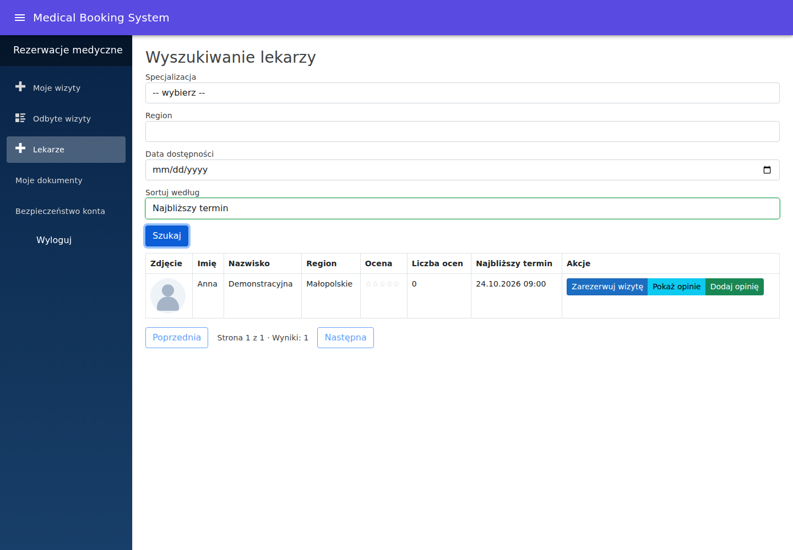
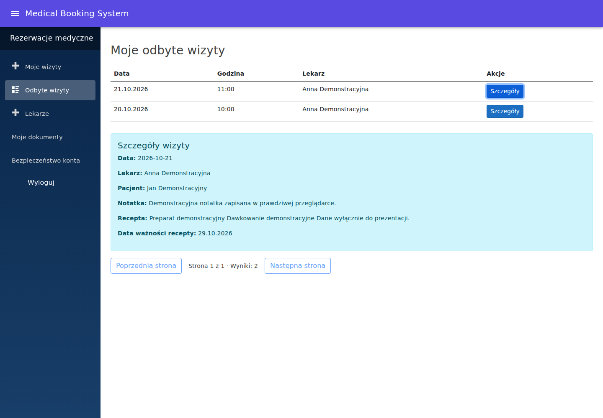
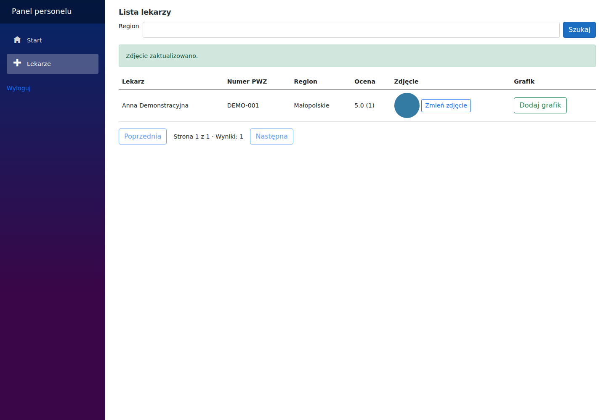
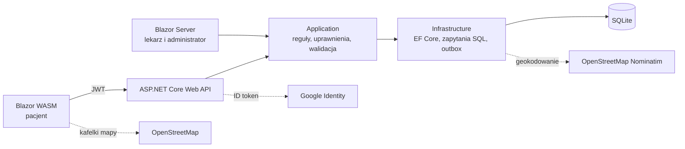

# Medical Booking System

[](https://github.com/Benvenuteo/Blazor-Medical-System/actions/workflows/ci.yml)


System rezerwacji wizyt lekarskich: pacjent znajduje lekarza na mapie w wybranym promieniu, rezerwuje realny termin z grafiku i dostaje potwierdzenie z plikiem do kalendarza; lekarz prowadzi kolejkę wizyt i dokumentację; administrator zarządza placówkami, lekarzami i kontami personelu.

Projekt pokazuje kompletną aplikację .NET 10 — od reguł domenowych i współbieżności w bazie, przez bezpieczeństwo kont (JWT, cookies, Google, blokady, unieważnianie sesji), po testy E2E, dostępność i wdrożenie w kontenerach na ARM64.

> **Demo:** po wdrożeniu (instrukcja: [DEPLOYMENT.md](docs/DEPLOYMENT.md)) aplikacja działa z publicznymi, fikcyjnymi kontami demo. Konta demo są chronione — można na nich rezerwować, dokumentować i oceniać, ale nie zmienić hasła ani ich zablokować.

| Rola | Email | Hasło |
| --- | --- | --- |
| Pacjent | `patient@example.test` | `DemoPatient2026!` |
| Lekarz | `doctor@example.test` | `DemoStaff2026!` |
| Administrator | `admin@example.test` | `DemoStaff2026!` |



<p>


</p>

## Co potrafi

**Pacjent (Blazor WebAssembly)**
- Wyszukiwanie lekarzy po specjalizacji, dacie i **lokalizacji**: adres lub lokalizacja przeglądarki, promień 10–100 km, widok listy lub **mapy** (Leaflet + OpenStreetMap), sortowanie po odległości, ocenie lub najbliższym terminie.
- Rezerwacja realnego 30-minutowego slotu z grafiku, zmiana terminu i odwołanie (≥ 24 h wcześniej); przy wizycie widać placówkę i link „Nawiguj”.
- Potwierdzenie rezerwacji i przypomnienie dzień wcześniej mailem, z wydarzeniem **.ics**; „Do kalendarza” z listy wizyt.
- Historia z notatkami i receptami lekarza, opinie tylko po odbytej wizycie.
- Konto: rejestracja z potwierdzeniem emaila, **logowanie przez Google**, reset hasła linkiem, wylogowanie wszystkich sesji.

**Lekarz i administrator (Blazor Server)**
- Kolejka wizyt, oznaczanie wizyt jako odbytych, notatki i recepty z audytem odczytów.
- Grafiki w konkretnych placówkach; **placówki z pinezką na mapie** i przypisaniem lekarzy.
- Konta personelu z hasłami tymczasowymi, dezaktywacją i ochroną ostatniego administratora; zdjęcia lekarzy z dekodowaniem i ponownym kodowaniem.

## Rozwiązania, o których warto porozmawiać

| Temat | Jak to działa |
| --- | --- |
| Brak podwójnych rezerwacji | Walidacja w usługach + unikalne indeksy i triggery przedziałów w SQLite + tokeny `Version`; testy równoległych żądań. |
| Wyszukiwanie w promieniu w SQLite | Prostokąt ograniczający (indeks) + dokładny haversine jako funkcja zarejestrowana na połączeniu; „najbliższy termin” liczony tylko z dyżurów w placówkach w zasięgu — jednym zapytaniem z CTE. |
| Migracje bez utraty triggerów | Kolumny z kluczem obcym dodawane natywnym `ALTER TABLE`, bo przebudowa tabeli przez EF usuwa triggery SQLite. |
| Sesje i konta | `SecurityStamp` sprawdzany przy każdym żądaniu (zmiana hasła = wylogowanie wszędzie), blokada po 5 próbach, równy czas odpowiedzi dla nieznanego emaila. |
| Google bez automatycznego łączenia kont | API weryfikuje ID token (klucze Google, `aud`, `nonce`) i wydaje własny JWT; konto dopasowane po `sub`, istniejące łączy właściciel po podaniu hasła. |
| Maile niezależne od serwera SMTP | Transakcyjny outbox w bazie, wysyłka w tle z ponowieniami; w demo zapis do plików `.eml`. |
| Publiczne demo, którego nie da się zepsuć | Konta demo chronione przed zmianą hasła, sesji i blokadą; grafiki demo same dokładają się na kolejne tygodnie. |
| Wdrożenie | Jeden Dockerfile (4 obrazy, kompilacja krzyżowa na ARM64), Caddy z automatycznym HTTPS, CI uruchamia cały stos w Compose i testuje go przez HTTPS. |

## Architektura



Uprawnienia są sprawdzane w warstwie aplikacji, więc bezpośrednie wywołanie usługi z obwodu Blazor Server nie omija zabezpieczeń kontrolerów. Szczegóły: [ARCHITECTURE.md](docs/ARCHITECTURE.md).

| Warstwa | Technologie |
| --- | --- |
| Backend | .NET 10, ASP.NET Core, EF Core, SQLite, FluentValidation, NLog, IdentityModel |
| Frontend | Blazor WebAssembly, Blazor Server, MudBlazor, Bootstrap, Leaflet |
| Testy | xUnit, Moq, bUnit, WebApplicationFactory, Playwright (Chromium, Firefox, mobile), axe-core |
| Wdrożenie | Docker (linux/amd64 i arm64), Docker Compose, Caddy, GitHub Actions |

## Testy

- **139 jednostkowych** — reguły slotów, walidatory, mapowania, odległości, format iCalendar.
- **213 integracyjnych** — prawdziwe API i SQLite: uprawnienia, współbieżność, migracje, sesje, Google, reset hasła, wyszukiwanie w promieniu, kopie zapasowe.
- **17 komponentowych** (bUnit) — kolejność odpowiedzi, formularze, komunikaty błędów.
- **Playwright** — pełne scenariusze pacjent–lekarz–administrator w przeglądarce, mapa z geolokalizacją, kontrole dostępności axe w Chromium, Firefoksie i widoku mobilnym.
- **Kontenery** — build obrazów (także ARM64), start stosu w Compose, test przez Caddy, backup i weryfikacja.

Strategia: [TESTING.md](docs/TESTING.md).

## Szybki start

Wymagany .NET SDK **10.0.113+** (`global.json`).

```bash
dotnet restore MedicalBookingSystem/MedicalBookingSystem.sln
dotnet build MedicalBookingSystem/MedicalBookingSystem.sln --configuration Release --no-restore
dotnet test MedicalBookingSystem/MedicalBookingSystem.sln --configuration Release --no-build --no-restore
```

W trzech terminalach (najpierw API — w Development nakłada migracje i dane demo):

```bash
dotnet run --project MedicalBookingSystem/MedicalBookingSystem.WebAPI
```

```bash
dotnet run --project MedicalBookingSystem/MedicalBookingSystem.BlazorWasm
```

```bash
dotnet run --project MedicalBookingSystem/MedicalBookingSystem.BlazorServer
```

| Aplikacja | Adres lokalny |
| --- | --- |
| Aplikacja pacjenta | http://localhost:5016 |
| API i Swagger | http://localhost:5031/swagger |
| Panel personelu | http://localhost:5187/Account/Login |
| Gotowość API (baza i migracje) | http://localhost:5031/health/ready |

Maile w Development trafiają jako pliki `.eml` do `MedicalBookingSystem/MedicalBookingSystem.WebAPI/data/mail` — tam są linki potwierdzenia i resetu hasła.

Całość w kontenerach (jak na serwerze): [DEPLOYMENT.md](docs/DEPLOYMENT.md).

## Konfiguracja

Ustawienia nadpisuje się zmiennymi środowiskowymi .NET, np.:

| Zmienna | Znaczenie |
| --- | --- |
| `ConnectionStrings__MedicalBookingSystem` | Wspólna baza SQLite API i panelu |
| `JwtSettings__SecretKey` | Klucz JWT (≥ 32 bajty), wymagany poza Development |
| `Cors__AllowedOrigins__0`, `AllowedHosts` | Adres aplikacji pacjenta, obsługiwane hosty |
| `Authentication__Google__ClientId` | Client ID Google (OAuth, typ Web); puste wyłącza logowanie Google |
| `Email__Mode` (`None`/`Pickup`/`Smtp`), `Email__SmtpHost`, … | Dostarczanie maili z outboxu |
| `Notifications__PatientAppUrl` | Adres aplikacji pacjenta w linkach z maili |
| `Geocoding__UserAgent` | Identyfikacja wdrożenia wobec Nominatim |
| `Seed__Enabled`, `Seed__PatientPassword`, `Seed__StaffPassword` | Fikcyjne dane i konta demo |
| `Demo__Enabled` | Baner wersji demonstracyjnej i dane logowania na stronie panelu |
| `Clinic__TimeZone` | Strefa placówki (domyślnie `Europe/Warsaw`) |
| `Media__PublicBaseUrl`, `Media__StoragePath` | Zdjęcia lekarzy ([MEDIA.md](docs/MEDIA.md)) |

Daty wizyt i grafików to lokalny czas placówki; znaczniki techniczne i ważność tokenów — UTC. Migracje: `dotnet ef database update --project MedicalBookingSystem/MedicalBookingSystem.Infrastructure --startup-project MedicalBookingSystem/MedicalBookingSystem.WebAPI` (po `dotnet tool restore`).

## Struktura

| Projekt | Odpowiedzialność |
| --- | --- |
| Domain | Encje, kontrakty repozytoriów, reguły slotów i odległości |
| Application | Przypadki użycia, uprawnienia, walidatory, powiadomienia, zegar placówki |
| Infrastructure | EF Core, SQLite, zapytania katalogu, outbox, geokodowanie, kopie zapasowe |
| SharedKernel | DTO, wyniki operacji, claims |
| WebAPI | HTTP, JWT, weryfikacja tokenów Google, limity żądań |
| BlazorWasm | Aplikacja pacjenta |
| BlazorServer | Panel lekarza i administratora |
| Maintenance | Kopie bazy i zdjęć, odtwarzanie, odzyskanie administratora |

## Dokumentacja

[Architektura](docs/ARCHITECTURE.md) · [API](docs/API.md) · [Rezerwacje](docs/BOOKING.md) · [Bezpieczeństwo](docs/SECURITY.md) · [Testy](docs/TESTING.md) · [Wydajność](docs/PERFORMANCE.md) · [Zdjęcia](docs/MEDIA.md) · [Utrzymanie](docs/OPERATIONS.md) · [Wdrożenie](docs/DEPLOYMENT.md) · [Scenariusz demo](docs/DEMO.md) · [Plan rozwoju](docs/IMPROVEMENT_PLAN.md)

Projekt działa na danych fikcyjnych i nie deklaruje gotowości do przetwarzania rzeczywistej dokumentacji medycznej — to wymagałoby osobnych decyzji organizacyjnych i prawnych.

---

Autor: **Krzysztof Włosek** · [github.com/Benvenuteo](https://github.com/Benvenuteo)
