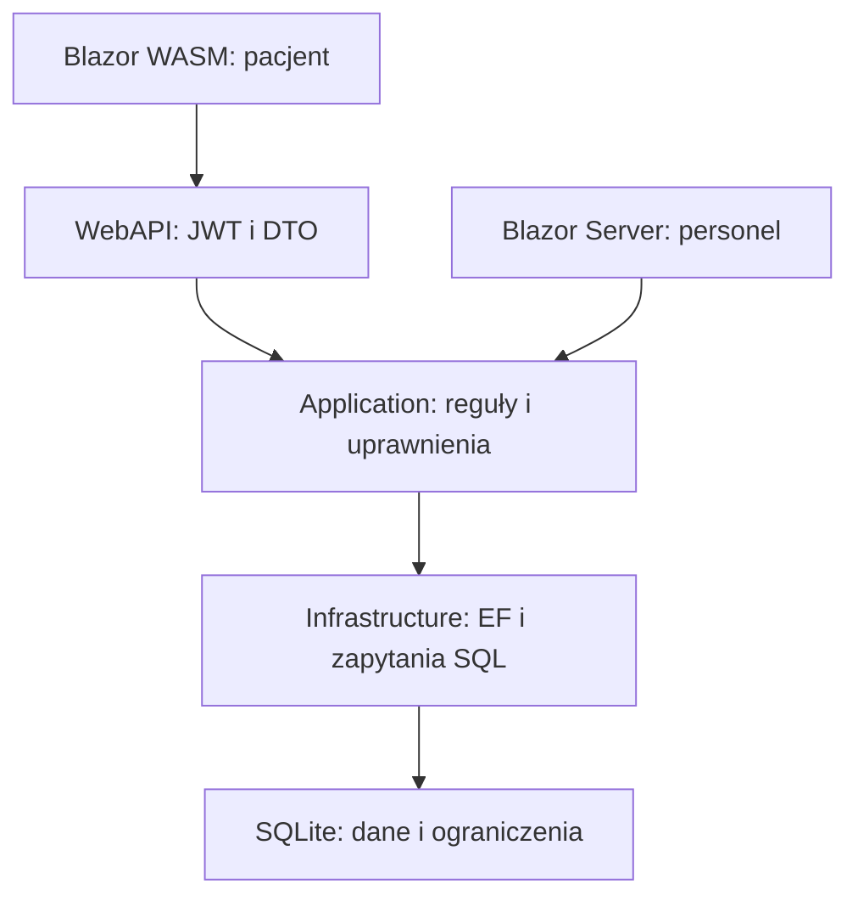

# Architektura i decyzje

Aplikacja ma dwa interfejsy korzystające z tych samych reguł biznesowych. Pacjent wywołuje WebAPI z Blazor WebAssembly, a personel korzysta z interaktywnego Blazor Server i usług aplikacyjnych. Kontrola uprawnień znajduje się również w usługach, dzięki czemu bezpośrednie wywołanie z obwodu nie omija zabezpieczeń kontrolera.

`Domain` zawiera encje i kontrakty, `SharedKernel` publiczne DTO oraz nazwy claims, `Application` przypadki użycia, walidatory, jawne mapowania i zegar. `Infrastructure` implementuje repozytoria, fabrykę operacji, odczyty i utrzymanie. Projekt `Maintenance` udostępnia polecenia operatora, bez dodawania do API uprawnień do plików kopii.

## Granice operacji

`IUnitOfWorkFactory` tworzy nowy kontekst EF na jedną operację i zwalnia go po jej zakończeniu. Obwód Blazor żyje dłużej od żądania HTTP; współdzielony kontekst gromadziłby śledzone encje i nie pozwalał na niezależne równoczesne operacje. Odczyty katalogu i kolejek mają osobne projekcje, bez materializowania grafów dokumentacji.

Usługi zwracają `Result`, a HTTP mapuje go na DTO/204 lub ProblemDetails. Odmowa dostępu pozostaje wyjątkiem obsługiwanym na granicy hosta. Nie zamieniamy nieoczekiwanej awarii przechowywania na pomyślny wynik lub komunikat walidacji.

## Reguły i współbieżność

Termin ma 30 minut, jest lokalnym czasem placówki i musi spełniać rzeczywiste 24 godziny wyprzedzenia oraz trzymiesięczny horyzont. `ClinicClock` korzysta z `TimeProvider`, dlatego testy kontrolują czas bez oczekiwania. Kalendarz pomija nieistniejące i niejednoznaczne lokalne godziny zmian czasu.

Walidacja przed zapisem daje czytelny błąd użytkownikowi. Unikalne indeksy, triggery przedziałów i tokeny `Version` rozstrzygają wyścigi w bazie. Spóźniona zmiana nie nadpisuje zatwierdzonego anulowania; przegrana zmiana terminu zachowuje poprzednią wizytę. SQLite wybrano dla odtwarzalnego lokalnego demo i testów rzeczywistych ograniczeń, nie jako deklarację skalowania wieloregionowego systemu.

## Tożsamość i audyt

Tożsamość pochodzi ze zweryfikowanego JWT albo cookie. W obwodzie personelu źródłem jest `AuthenticationStateProvider`. `SecurityStamp` jest sprawdzany w aktualnym koncie przy chronionych operacjach; `Version` służy osobno do wykrywania spóźnionych zapisów. Hasło tymczasowe ogranicza konto do zmiany hasła i wylogowania.

Metadane audytu powstają w tej samej jednostce pracy co dokument. Zapis obu jest atomowy, a odczyt kliniczny nie zostaje wydany przy awarii zapisu rejestru. Audyt nie kopiuje tekstu dokumentacji. Ochrona triggerami dotyczy zwykłych zapisów bazy, a nie operatora mającego kontrolę nad jej plikiem.

## Koszt odczytów i plików

Filtrowanie, agregaty, sortowanie i podział stron wykonywane są przed materializacją w SQLite. Dostępność katalogu korzysta z ograniczonego kalendarza i rekurencyjnego CTE wewnątrz realnych grafików, zamiast z grafów wszystkich wizyt. Historia korzysta z indeksów właściciel/status/data/Id. Liczba wyników i strona to osobne odczyty; zapis rezerwacji zawsze sprawdza bieżący stan.

Plik i SQLite nie tworzą jednej transakcji. Zmiana zdjęcia korzysta z dekodowania, ponownego kodowania, nazw generowanych na serwerze, kompensacji i sprzątania osieroconych plików. Backup obejmuje spójny snapshot SQLite i wskazane zdjęcia; brak zdjęcia przerywa publikację kopii. Szczegóły ograniczeń i odzyskiwania zawierają [MEDIA.md](MEDIA.md) oraz [OPERATIONS.md](OPERATIONS.md).
