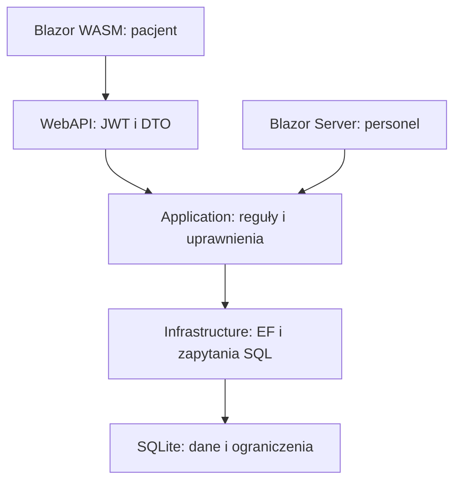

# Architektura i decyzje

Aplikacja ma dwa interfejsy korzystające z tych samych reguł biznesowych. Pacjent wywołuje WebAPI z Blazor WebAssembly, a personel korzysta z interaktywnego Blazor Server i usług aplikacyjnych. Kontrola uprawnień znajduje się również w usługach, dzięki czemu bezpośrednie wywołanie z obwodu nie omija zabezpieczeń kontrolera.

`Domain` zawiera encje i kontrakty, `SharedKernel` publiczne DTO oraz nazwy claims, `Application` przypadki użycia, walidatory, jawne mapowania i zegar. `Infrastructure` implementuje repozytoria, fabrykę operacji, odczyty i utrzymanie. Projekt `Maintenance` udostępnia polecenia operatora, bez dodawania do API uprawnień do plików kopii.

## Granice operacji

`IUnitOfWorkFactory` tworzy nowy kontekst EF na jedną operację i zwalnia go po jej zakończeniu. Obwód Blazor żyje dłużej od żądania HTTP; współdzielony kontekst gromadziłby śledzone encje i nie pozwalał na niezależne równoczesne operacje. Odczyty katalogu i kolejek mają osobne projekcje, bez materializowania grafów dokumentacji.

Usługi zwracają `Result`, a HTTP mapuje go na DTO/204 lub ProblemDetails. Odmowa dostępu pozostaje wyjątkiem obsługiwanym na granicy hosta. Nie zamieniamy nieoczekiwanej awarii przechowywania na pomyślny wynik lub komunikat walidacji.

## Reguły i współbieżność

Termin ma 30 minut, jest lokalnym czasem placówki i musi spełniać rzeczywiste 24 godziny wyprzedzenia oraz trzymiesięczny horyzont. `ClinicClock` korzysta z `TimeProvider`, dlatego testy kontrolują czas bez oczekiwania. Kalendarz pomija nieistniejące i niejednoznaczne lokalne godziny zmian czasu.

Walidacja przed zapisem daje czytelny błąd użytkownikowi. Unikalne indeksy, triggery przedziałów i tokeny `Version` rozstrzygają wyścigi w bazie. Spóźniona zmiana nie nadpisuje zatwierdzonego anulowania; przegrana zmiana terminu zachowuje poprzednią wizytę. SQLite wybrano dla odtwarzalnego lokalnego demo i testów rzeczywistych ograniczeń, nie jako deklarację skalowania wieloregionowego systemu.

## Tożsamość i audyt

Tożsamość pochodzi ze zweryfikowanego JWT albo cookie. W obwodzie personelu źródłem jest `AuthenticationStateProvider`. `SecurityStamp` jest sprawdzany w aktualnym koncie przy chronionych operacjach; `Version` służy osobno do wykrywania spóźnionych zapisów. Hasło tymczasowe ogranicza konto do zmiany hasła i wylogowania.

Metadane audytu powstają w tej samej jednostce pracy co dokument. Zapis obu jest atomowy, a odczyt kliniczny nie zostaje wydany przy awarii zapisu rejestru. Audyt nie kopiuje tekstu dokumentacji. Ochrona triggerami dotyczy zwykłych zapisów bazy, a nie operatora mającego kontrolę nad jej plikiem.

## Koszt odczytów i plików

Filtrowanie, agregaty, sortowanie i podział stron wykonywane są przed materializacją w SQLite. Dostępność katalogu korzysta z ograniczonego kalendarza i rekurencyjnego CTE wewnątrz realnych grafików, zamiast z grafów wszystkich wizyt. Historia korzysta z indeksów właściciel/status/data/Id. Liczba wyników i strona to osobne odczyty; zapis rezerwacji zawsze sprawdza bieżący stan.

Plik i SQLite nie tworzą jednej transakcji. Zmiana zdjęcia korzysta z dekodowania, ponownego kodowania, nazw generowanych na serwerze, kompensacji i sprzątania osieroconych plików. Backup obejmuje spójny snapshot SQLite i wskazane zdjęcia; brak zdjęcia przerywa publikację kopii. Szczegóły ograniczeń i odzyskiwania zawierają [MEDIA.md](MEDIA.md) oraz [OPERATIONS.md](OPERATIONS.md).

## Placówki i wyszukiwanie w promieniu

Lekarz pracuje w wielu placówkach (`DoctorClinic`); dyżur (`DoctorSchedule.ClinicId`) odbywa się w jednej z nich, a wizyta kopiuje placówkę przy rezerwacji, więc późniejsza zmiana grafiku nie przepisuje historii. Grafiki sprzed wprowadzenia placówek mają `ClinicId = null`.

Wyszukiwanie z punktem i promieniem to jedno zapytanie SQL: CTE `NearbyClinics` filtruje placówki prostokątem ograniczającym (indeks na współrzędnych, granice liczone w C#) i dokładną odległością `haversine` — funkcją .NET rejestrowaną na połączeniu SQLite jak istniejąca collation. Lekarz kwalifikuje się, jeśli przyjmuje w placówce w zasięgu; „najbliższy termin” liczony jest tylko z dyżurów w tych placówkach. Najbliższa placówka i odległość wracają w wynikach (`ROW_NUMBER` po odległości).

Migracja `ClinicsAndMapSearch` dodaje kolumny z kluczem obcym natywnym `ALTER TABLE ... ADD COLUMN ... REFERENCES`. `AddForeignKey` w EF dla SQLite przebudowałby tabele `Appointments` i `DoctorSchedules`, a przebudowa po cichu usuwa ich triggery przedziałów. Z tego samego powodu migracji nie da się cofnąć w miejscu — przywraca się kopię.

## Powiadomienia

Maile powstają w transakcyjnym outboxie (`EmailOutbox`) razem ze zmianą, która je wywołała, i są dostarczane w tle z wykładniczym odstępem ponowień. Tryb `Pickup` zapisuje pliki `.eml` (development, demo), `Smtp` wysyła je. Potwierdzenie rezerwacji jest zapisywane po rezerwacji (potrzebuje jej identyfikatora do UID wydarzenia) i jest „best effort”: zajęta baza nie zmienia zapisanej rezerwacji w błąd. Przypomnienia na jutro kolejkuje godzinne zadanie; `ReminderQueuedAtUtc` gwarantuje jedno przypomnienie na wizytę. Pliki iCalendar używają czasu UTC.

## Zewnętrzne usługi

| Usługa | Do czego | Gdy niedostępna |
| --- | --- | --- |
| Google Identity Services | Logowanie pacjentów przez Google | Przycisk ukryty bez Client ID; logowanie hasłem działa |
| OpenStreetMap Nominatim | Adres → współrzędne (przez API, 1 żądanie/s, cache 24 h) | Komunikat; można użyć lokalizacji przeglądarki |
| Kafelki OpenStreetMap, Leaflet (cdnjs) | Mapa pacjenta i administratora | Widok listy działa bez mapy |
| Serwer SMTP | Wysyłka maili | Wiadomości czekają w outboxie i są ponawiane |
