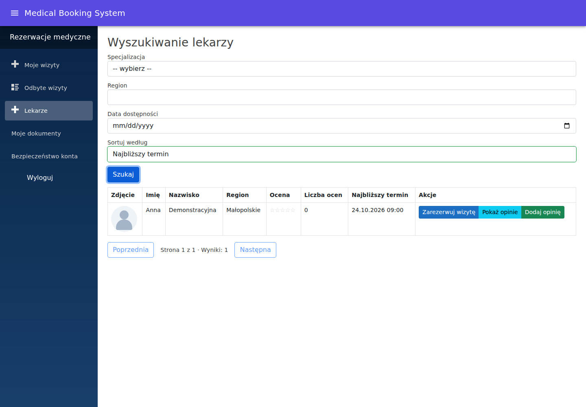
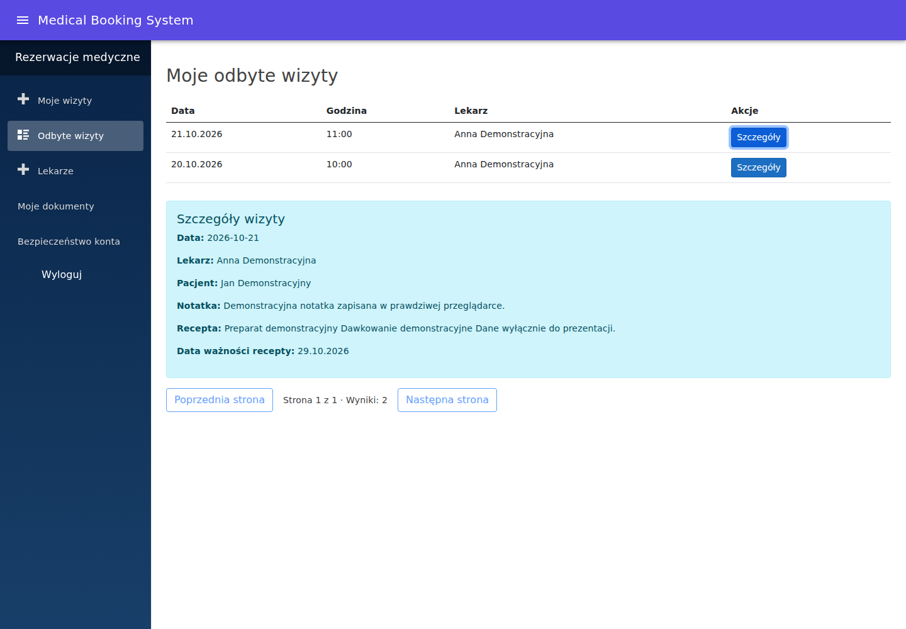
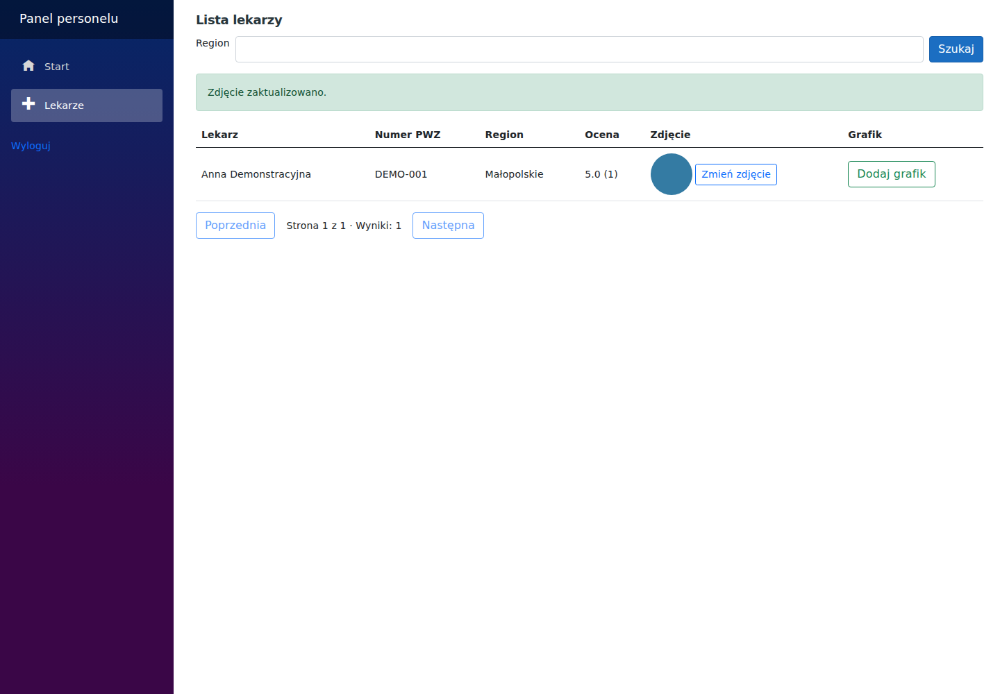

# Demonstracja projektu

Zrzuty pochodzą z rzeczywistych scenariuszy Playwright i zawierają wyłącznie fikcyjne dane. Instrukcja uruchomienia oraz konta demo znajdują się w [README](../README.md).

## Pacjent: katalog i rezerwacja

Pacjent filtruje i sortuje katalog, porównuje oceny oraz pierwszy wolny termin, a następnie rezerwuje konkretny półgodzinny slot. Może przenieść albo anulować zaplanowaną wizytę z wyprzedzeniem co najmniej 24 godzin.

## Pacjent: lekarze w okolicy na mapie

Na stronie **Lekarze** wpisz adres (np. „Kraków, Rynek Główny”) albo użyj lokalizacji przeglądarki i zostaw promień 30 km. Wyniki obejmują trzech lekarzy z Krakowa i Wieliczki — Katowice (~70 km) i Warszawa są poza zasięgiem. Przełącz na **Mapa**: pinezki placówek, okrąg promienia i lekarze z najbliższym terminem w dymku. Zwiększ promień do 100 km, aby pojawiły się Katowice. Gdy przeglądarka nie udostępni lokalizacji (odmowa albo brak odpowiedzi przez 15 s), mapa startuje w Warszawie, gdzie jest jedna placówka demo; pusty wynik też zostawia mapę z obszarem wyszukiwania.

Po rezerwacji lista wizyt pokazuje placówkę z linkiem „Nawiguj” i przyciskiem **Do kalendarza** (.ics). Potwierdzenie i przypomnienie trafiają do outboxu — w demo jako pliki `.eml`.

## Konta i bezpieczeństwo

Na koncie demo otwórz **Bezpieczeństwo konta**: zmiana hasła i wylogowanie wszystkich sesji są wyłączone z wyjaśnieniem, a reszta aplikacji działa. Załóż własne konto, żeby pokazać potwierdzenie emaila, „Nie pamiętasz hasła?” i — gdy skonfigurowano Client ID — logowanie przez Google z uzupełnieniem profilu.

## Dokumentacja po odbytej wizycie

Przypisany lekarz oznacza zakończoną wizytę jako odbytą i dodaje notatkę oraz receptę. Pacjent odczytuje je w historii. Uprawnienia są weryfikowane również w usługach i API.

## Administrator: lekarze i zdjęcia

Administrator korzysta ze stronicowanego katalogu, zastępuje zdjęcie lekarza i dodaje grafik. Test przeglądarkowy sprawdza również odrzucenie tekstu przesłanego jako JPG.

Na koncie administratora otwórz **Placówki**: lista placówek, wyszukanie adresu na mapie, przeciąganie pinezki i przypisanie lekarzy. Formularz grafiku pyta o placówkę, jeśli lekarz pracuje w którejś z nich.

Raport każdego przebiegu CI zawiera aktualne zrzuty, a przy błędzie również ślad Playwright. Reguły działania opisują [BOOKING.md](BOOKING.md), [API.md](API.md) i [MEDIA.md](MEDIA.md).

## Domknięcie prezentacji

1. Na koncie pacjenta otwórz **Moje dokumenty** i szczegóły notatki/recepty. Strony list nie pobierają treści wszystkich dokumentów.
2. Na koncie administratora przejdź do **Audyt dokumentacji**. Pokaż konto/rolę, operację i identyfikator wizyty, bez kopiowania dokumentacji do rejestru.
3. W panelu lekarza pokaż filtrowanie kolejki datą i stronicowanie pozycji oczekujących na dokument.
4. Zmniejsz okno do szerokości telefonu. Pacjent ma menu rozwijane z górnego paska; tabele przewijają się we własnym obszarze i są dostępne klawiaturą.
5. Wyjaśnij test backupu: otwarty WAL, snapshot bazy i zdjęcia, weryfikacja SHA-256, odtworzenie do nowego katalogu i odwołanie starych sesji. Polecenia do wykonania na osobnej kopii demo znajdują się w [OPERATIONS.md](OPERATIONS.md).

W rozmowie o projekcie omów decyzje z [ARCHITECTURE.md](ARCHITECTURE.md), przypadki wyścigów i sposób testowania awarii. Wynik pomiaru katalogu jest lokalnym porównaniem zapytań, a liczba testów nie jest sama w sobie dowodem gotowości produkcyjnej.
