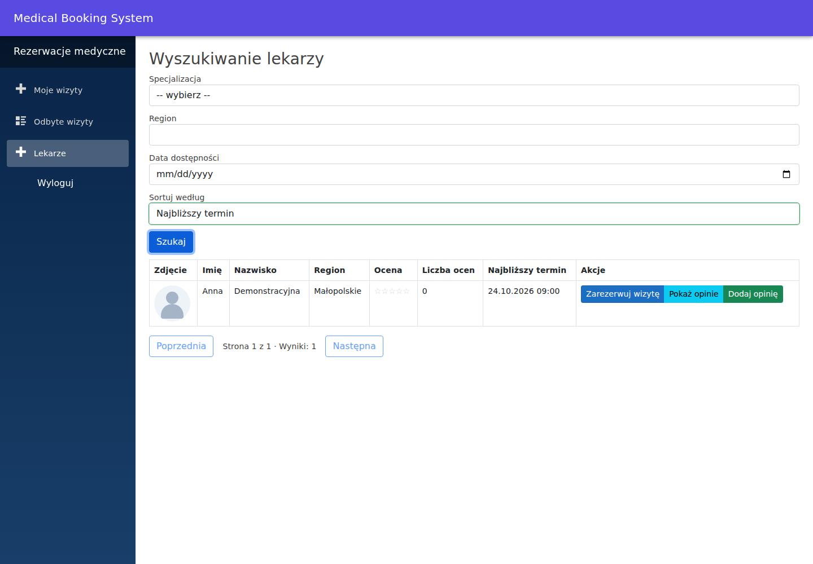
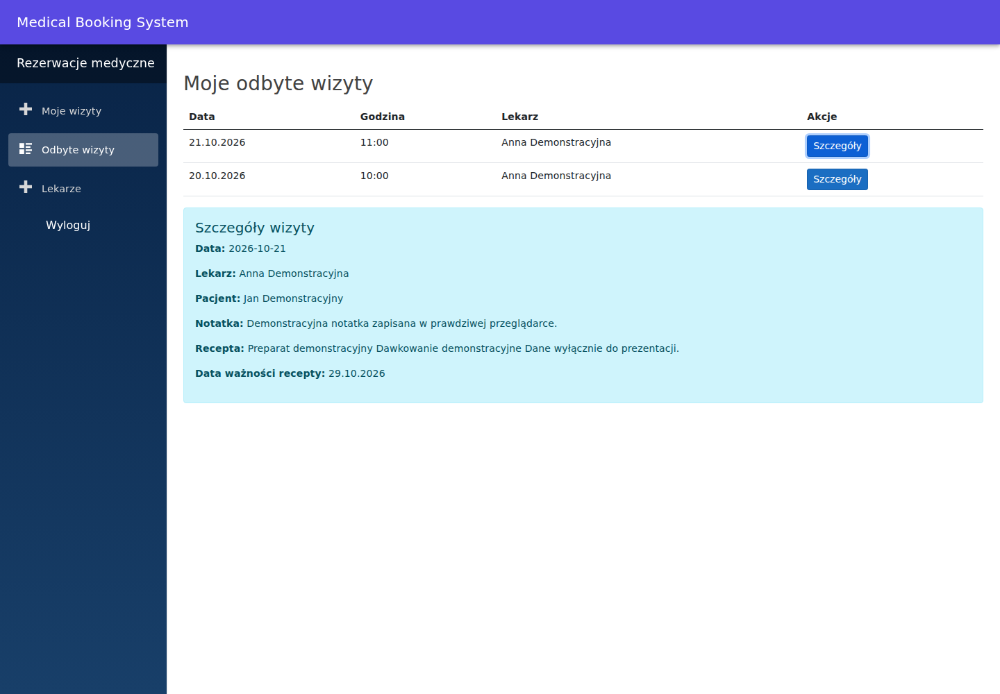
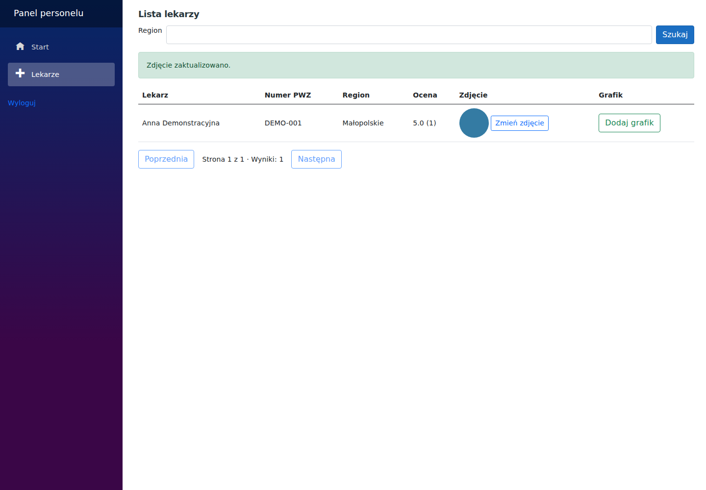

# Demonstracja projektu

Zrzuty pochodzą z rzeczywistych scenariuszy Playwright i zawierają wyłącznie fikcyjne dane. Instrukcja uruchomienia oraz konta demo znajdują się w [README](../README.md).

## Pacjent: katalog i rezerwacja

Pacjent filtruje i sortuje katalog, porównuje oceny oraz pierwszy wolny termin, a następnie rezerwuje konkretny półgodzinny slot. Może przenieść albo anulować zaplanowaną wizytę z wyprzedzeniem co najmniej 24 godzin.

## Dokumentacja po odbytej wizycie

Przypisany lekarz oznacza zakończoną wizytę jako odbytą i dodaje notatkę oraz receptę. Pacjent odczytuje je w historii. Uprawnienia są weryfikowane również w usługach i API.

## Administrator: lekarze i zdjęcia

Administrator korzysta ze stronicowanego katalogu, zastępuje zdjęcie lekarza i dodaje grafik. Test przeglądarkowy sprawdza również odrzucenie tekstu przesłanego jako JPG.

Raport każdego przebiegu CI zawiera aktualne zrzuty, a przy błędzie również ślad Playwright. Reguły działania opisują [BOOKING.md](BOOKING.md), [API.md](API.md) i [MEDIA.md](MEDIA.md).
