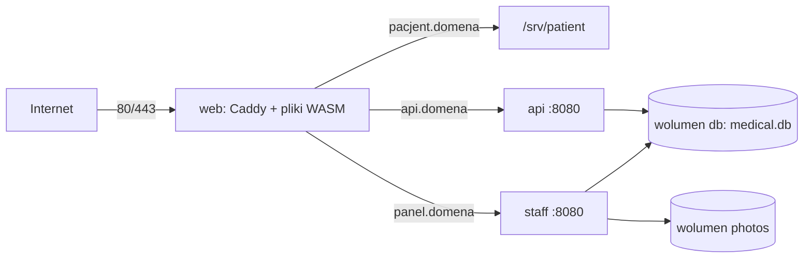

# Wdrożenie demo w kontenerach (Oracle Cloud Always Free)

Cała aplikacja działa na jednej maszynie w Docker Compose: API, panel personelu i aplikacja pacjenta za serwerem Caddy. API i panel korzystają z tego samego pliku SQLite, dlatego muszą stać na jednym hoście i wspólnym wolumenie. Caddy sam pobiera i odnawia certyfikaty Let's Encrypt.



| Plik | Rola |
| --- | --- |
| `deploy/docker/Dockerfile` | Obrazy `api`, `staff`, `web` i `maintenance`; buduje także na ARM64 |
| `deploy/docker/Caddyfile` | HTTPS, nagłówki bezpieczeństwa, pliki pacjenta i reverse proxy |
| `deploy/docker-compose.yml` | Usługi, wolumeny i stałe adresy sieci wewnętrznej |
| `deploy/.env.example` | Wzór konfiguracji; prawdziwy `deploy/.env` nie trafia do Git |
| `deploy/scripts/create-secrets.sh` | Klucz JWT, hasło i certyfikat Data Protection panelu |

## 1. Maszyna w Oracle Cloud

1. Załóż konto Oracle Cloud (region np. Frankfurt). Rejestracja wymaga karty do weryfikacji; zasoby **Always Free** są bezpłatne. Ustaw budżet z alertem (np. 1 zł), żeby od razu wiedzieć o ewentualnych kosztach.
2. Utwórz instancję: obraz **Ubuntu 24.04**, kształt **VM.Standard.A1.Flex** (Ampere, ARM64), np. 2 OCPU i 12 GB RAM. Dodaj swój publiczny klucz SSH. Komunikat „Out of host capacity” oznacza chwilowy brak maszyn — spróbuj innej domeny dostępności albo później.
3. W **Security List** podsieci dodaj reguły przychodzące TCP 80 i 443 (oraz UDP 443 dla HTTP/3) ze źródła `0.0.0.0/0`. Port 22 zostaw tylko dla SSH.
4. Obraz Ubuntu w Oracle ma własne reguły `iptables`, które blokują ruch mimo Security List. Na maszynie:

   ```bash
   sudo iptables -I INPUT 6 -m state --state NEW -p tcp --dport 80 -j ACCEPT
   sudo iptables -I INPUT 6 -m state --state NEW -p tcp --dport 443 -j ACCEPT
   sudo iptables -I INPUT 6 -m state --state NEW -p udp --dport 443 -j ACCEPT
   sudo netfilter-persistent save
   ```

5. Zainstaluj Docker Engine z pluginem Compose według [instrukcji dla Ubuntu](https://docs.docker.com/engine/install/ubuntu/) i dodaj użytkownika do grupy `docker`.
6. Oracle może odebrać maszynę Always Free, która przez 7 dni prawie nie pracuje. Konto Pay As You Go (nadal 0 zł w limitach Always Free) zdejmuje to ryzyko; regularne kopie z punktu 5 pozwalają odtworzyć demo na nowej maszynie.

## 2. Domeny

Potrzebne są trzy nazwy wskazujące publiczny adres IP maszyny, np. darmowe subdomeny [DuckDNS](https://www.duckdns.org): `medical-demo`, `medical-api`, `medical-staff`. Ustaw je przed startem — Caddy pobiera certyfikaty przy pierwszym żądaniu i potrzebuje działającego DNS oraz otwartego portu 80.

## 3. Konfiguracja

```bash
git clone https://github.com/Benvenuteo/Blazor-Medical-System.git
cd Blazor-Medical-System
sh deploy/scripts/create-secrets.sh
nano deploy/.env
```

Skrypt tworzy `deploy/.env` z wzoru, generuje `JWT_SECRET_KEY`, hasło certyfikatu i `deploy/secrets/dataprotection.pfx`. Istniejących wartości nie nadpisuje. W `deploy/.env` uzupełnij `PATIENT_HOST`, `API_HOST`, `STAFF_HOST` i `ACME_EMAIL`. `.env` i `secrets/` przechowuj w kopii poza serwerem — bez nich istniejące sesje i ciasteczka panelu przestaną działać.

`DEMO_DATA=true` włącza fikcyjne konta z README. To celowo publiczne dane demonstracyjne; dla wdrożenia bez nich ustaw `DEMO_DATA=false` i utwórz administratora narzędziem z punktu 5.

### Opcjonalnie: logowanie Google i prawdziwe maile

- **Google:** w Google Cloud Console utwórz OAuth Client ID typu *Web application*, w *Authorized JavaScript origins* dodaj `https://PATIENT_HOST` (lokalnie także `http://localhost:5016` i `http://localhost`) i wpisz go jako `GOOGLE_CLIENT_ID`. Bez niego przycisk Google się nie pokazuje.
- **Maile:** `EMAIL_MODE=Smtp` i dane `SMTP_*` (np. darmowy plan dostawcy maili transakcyjnych). Domyślne `Pickup` zapisuje wiadomości jako `.eml` w wolumenie `mail`.

## 4. Uruchomienie i aktualizacja

```bash
docker compose -f deploy/docker-compose.yml --env-file deploy/.env up -d --build
docker compose -f deploy/docker-compose.yml --env-file deploy/.env ps
```

Na maszynie ARM obrazy budują się natywnie. Kolejność startu wynika z kontroli zdrowia: API nakłada migracje i dopiero po `/health/ready` startuje panel, a potem Caddy. Aktualizacja to `git pull` i ponownie to samo polecenie `up -d --build`; wolumeny `db`, `photos` i `keys` zostają.

Sprawdzenie z zewnątrz:

```bash
curl -fsS https://medical-api.duckdns.org/health/ready
```

Logi: `docker compose -f deploy/docker-compose.yml --env-file deploy/.env logs -f api staff web`.

## 5. Kopie zapasowe i odzyskanie dostępu

Narzędzie `Maintenance` działa jako osobny obraz, uruchamiany na żądanie. Katalog kopii musi należeć do użytkownika kontenera (UID 1654):

```bash
sudo mkdir -p /srv/medical-backups && sudo chown 1654:1654 /srv/medical-backups
# w deploy/.env: BACKUP_DIR=/srv/medical-backups
docker compose -f deploy/docker-compose.yml --env-file deploy/.env run --rm maintenance \
  backup /data/db/medical.db /data/photos /backups/medical-$(date +%F)
docker compose -f deploy/docker-compose.yml --env-file deploy/.env run --rm maintenance \
  verify /backups/medical-$(date +%F)
```

Codzienna kopia z rotacją 7 dni (`crontab -e`, ścieżkę repozytorium dostosuj):

```cron
30 3 * * * cd ~/Blazor-Medical-System && docker compose -f deploy/docker-compose.yml --env-file deploy/.env run --rm maintenance backup /data/db/medical.db /data/photos /backups/medical-$(date +\%F) && find /srv/medical-backups -maxdepth 1 -name 'medical-*' -mtime +7 -exec rm -rf {} +
```

Odtwarzanie, `create-admin` i `reset-admin` działają tak jak w [OPERATIONS.md](OPERATIONS.md), ze ścieżkami z kontenera (`/data/db/medical.db`, `/backups/...`). Polecenia zmieniające bazę uruchamiaj przy zatrzymanych usługach `api` i `staff` (`docker compose ... stop api staff`), a hasło podawaj w konsoli (`run --rm -it maintenance reset-admin ...`).

## Lokalny test kontenerów

Nazwy `*.localhost` nie wymagają DNS; Caddy wystawia dla nich certyfikat z własnego, lokalnego urzędu certyfikacji (przeglądarka pokaże ostrzeżenie):

```bash
PATIENT_HOST=patient.localhost API_HOST=api.localhost STAFF_HOST=staff.localhost \
  docker compose -f deploy/docker-compose.yml --env-file deploy/.env up -d --build
curl -k --resolve api.localhost:443:127.0.0.1 https://api.localhost/health/ready
```

## Ograniczenia

- SQLite i jeden host to świadomy wybór dla demo; nie skaluje się poziomo.
- Kopie trzymane na tej samej maszynie nie chronią przed jej utratą — kopiuj je okresowo poza serwer.
- Konta demo są publiczne; ich ochrona przed zmianą hasła i automatyczne dokładanie grafików są w planie (`docs/IMPROVEMENT_PLAN.md`, część E).
